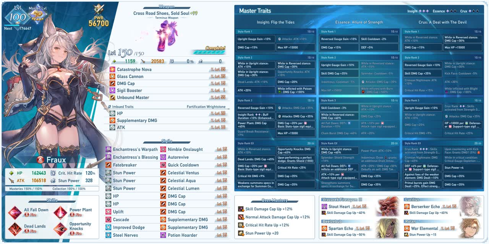
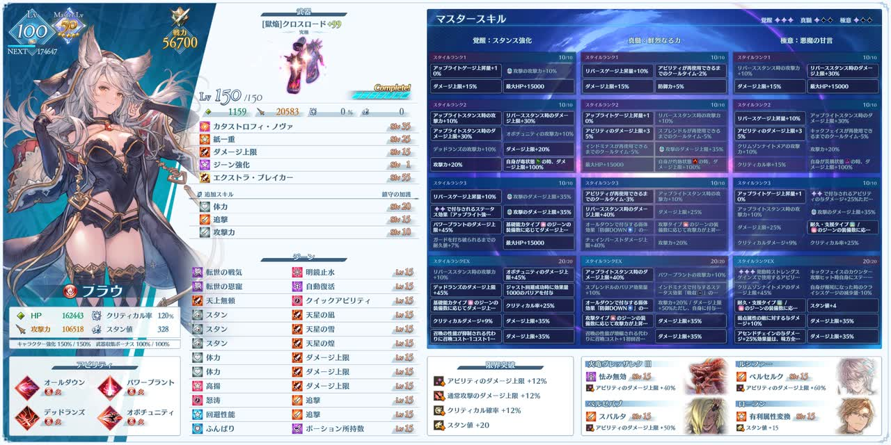

# Character Build Card

A Granblue Fantasy: Relink mod that replaces the Character Details panel with a build card.

## Features

- **One card with the character's whole build**: portrait, level, Master Lvl and PWR, stats, masteries, Master Traits,
  Over Mastery, skills, summons, weapon with its weapon and wrightstone traits, and sigils.
- **A custom 'Take Photo' option**: Saves the card as a 2880x1440 PNG (or JPEG), to `Pictures/GBFR Character Build Cards/`.
- **All game languages supported**: English, Japanese, French, Italian, German, Spanish, Portuguese, Korean and Chinese (Simplified/Traditional).

## Installation

Requirements: [Reloaded-II](https://github.com/Reloaded-Project/Reloaded-II)
and [GBFR Mod Manager](https://github.com/WistfulHopes/gbfrelink.utility.manager)

1. Download the latest release.
2. Drag the zip into the mods folder of Reloaded-II.
3. Enable **Character Build Card** for `granblue_fantasy_relink.exe`.
4. Launch the game through Reloaded-II.

## Configuration

Set in Reloaded-II under the mod's **Configure Mod**.

| Option | Default | Effect |
|---|---|---|
| Exported File Format | PNG | File format of saved cards: PNG (lossless, ~3 MB) or JPEG (~1 MB). |
| Enable Steam Screenshots | Off | Also adds each saved card to the game's Steam screenshots. |
| Master Traits Palette | Blue | Colours of the Master Traits section: Blue, matching the portrait, or the game's Original. |

## Compatibility

- Made for game version 2.0.6.
- Conflicts with mods that replace `ui/layouts/pause/status/prefabs/status01` or `ui/table/guide_button.msg`.

## Other Languages

*the card renders in japanese with the game's color palette for the master traits*
